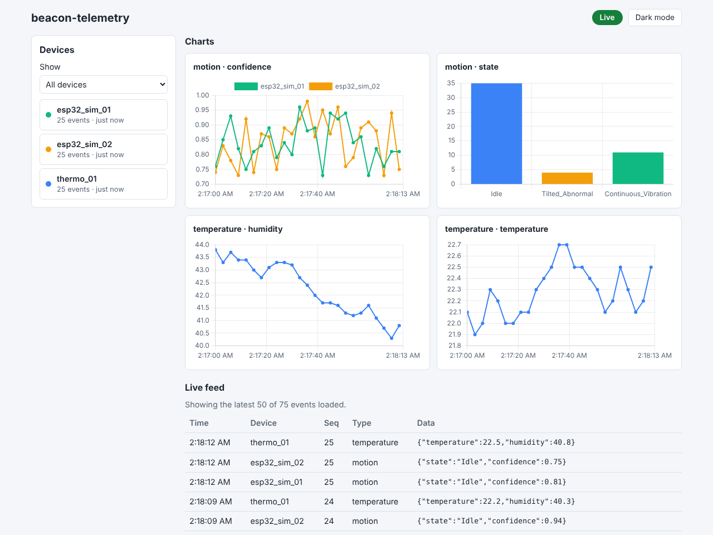

# beacon-telemetry
Real-time IoT telemetry platform: a FastAPI + SQLite backend, a WebSocket live feed, and a Chart.js dashboard. Any device that can send JSON over HTTP can feed it.

**Live demo: [https://beacon-telemetry.onrender.com](https://beacon-telemetry.onrender.com)**

> The data on the demo is simulated by the server (devices named `demo_*`). The demo runs on a free host, so if it has been idle, the first load can take up to a minute to wake up.

<picture>
  <source media="(prefers-color-scheme: dark)" srcset="docs/dashboard-dark.png">
  
</picture>

*The dashboard with three simulated devices (two motion sensors and a temperature sensor).*

## Features

- **One endpoint for any device.** `POST /events` accepts a JSON event. Device-specific readings go in a free-form `data` object, so a motion sensor, a thermometer and an RFID reader all use the same API.
- **Validation.** Every event is checked with Pydantic. Bad events get a `422` response and are never stored.
- **Persistence.** Events are saved to SQLite and survive restarts.
- **Live updates.** Each saved event is pushed to every open dashboard over a WebSocket.
- **Dashboard.** Connection badge, device list with last-seen times, per-device filter, live event feed, history loaded when the page opens, a Clear button, and light/dark mode.
- **Automatic charts.** Charts are chosen from the data, not hard-coded per device: a numeric field becomes a line chart (one line per device), and a text field with a few distinct values becomes a bar chart of counts. A chart shows the current run only: after a long pause in the data, new readings start a fresh chart instead of being joined to old ones.
- **Test without hardware.** A simulator script sends realistic fake events.
- **Device authentication.** Optional API keys: each key belongs to one device, is stored only as a hash, and can be revoked on its own. Events without a valid key are rejected, and there is a per-key rate limit.
- **Demo mode.** One setting makes the server generate its own simulated devices, so a public link always shows live charts.
- **Docker support.** One command starts everything.

## Quick start

### Option 1: Docker

Requires [Docker Desktop](https://www.docker.com/products/docker-desktop/) (or Docker Engine with Compose).

```bash
git clone https://github.com/trikzen/beacon-telemetry.git
cd beacon-telemetry
docker compose up --build
```

Open <http://localhost:8000>. Data is kept in a Docker volume between restarts. To wipe it, run `docker compose down -v`.

### Option 2: Python

Requires Python 3.10 or newer (developed on 3.14, tested on 3.13).

Windows (PowerShell):

```powershell
python -m venv venv
venv\Scripts\Activate.ps1
pip install -r backend/requirements.txt
cd backend
python -m uvicorn main:app --reload
```

macOS / Linux:

```bash
python3 -m venv venv
source venv/bin/activate
pip install -r backend/requirements.txt
cd backend
python -m uvicorn main:app --reload
```

Open <http://localhost:8000>. The database file `telemetry.db` is created in the folder you started the server from.

### Demo mode (no simulator needed)

Set `BEACON_DEMO=1` and the server makes up six devices of its own (motion, climate and water quality, named `demo_*`). Charts move as soon as the page opens, and a banner on the dashboard says the data is simulated.

Docker (PowerShell):

```powershell
$env:BEACON_DEMO=1; docker compose up --build
```

Python (PowerShell, from `backend/`):

```powershell
$env:BEACON_DEMO=1; python -m uvicorn main:app --reload
```

macOS / Linux: `BEACON_DEMO=1 docker compose up --build`, or `BEACON_DEMO=1 python -m uvicorn main:app --reload`.

It is off by default. Demo events go through the same validation, storage and live feed as real ones, and the server keeps only the newest few thousand demo events, so the database never grows without limit (events from other devices are never deleted). In PowerShell the variable stays set for that window; remove it with `Remove-Item Env:BEACON_DEMO`.

### Send some data (no hardware needed)

In a second terminal, from the repository root:

```bash
python examples/fake_device.py --devices 3 --count 30 --interval 0.5
```

Sensor types it can simulate:

| Type | Device names | Event type | Readings |
| :--- | :--- | :--- | :--- |
| `motion` | `esp32_sim_01`, ... | `motion` | `state` (Idle, Continuous_Vibration, Tilted_Abnormal), `confidence` |
| `climate` | `climate_01`, ... | `climate` | `temperature` (C), `humidity` (%) |
| `water` | `water_01`, ... | `water_quality` | `ph`, `temperature` (C), `status` (OK, Too_Acidic, Too_Alkaline) |

Readings drift gradually like a real sensor. For a quick random demo with no options to remember:

```bash
python examples/fake_device.py --rand
```

Or a mixed run with live updates until you press Ctrl+C:

```bash
python examples/fake_device.py --type all --devices 6 --count 0 --interval 1
```

| Option | Default | Meaning |
| :--- | :--- | :--- |
| `--url` | `http://localhost:8000/events` | Where to send events |
| `--rand` | off | Pick random settings for anything you don't give (types, devices, count, interval). Prints what it chose and a `--seed` to repeat the run |
| `--devices` | `1` | Number of simulated devices |
| `--type` | `motion` | Sensor type: `motion`, `climate`, `water`, `all`, or a comma list such as `climate,water`. With several types, devices take turns |
| `--count` | `10` | Rounds to send (`0` = run until Ctrl+C) |
| `--interval` | `1.0` | Seconds between rounds |
| `--invalid-rate` | `0` | Fraction of events deliberately broken (`0` to `1`), to see validation at work |
| `--seed` | none | Random seed, for repeatable runs |
| `--key` | none | API key to send, for servers that require keys (or set the `BEACON_API_KEY` environment variable) |
| `--device-id` | none | Use this exact device id instead of the generated names (needs `--devices 1`). A key only works for the device id it was made for |

## Send your own events

Anything that can make an HTTP request can be a device: a microcontroller, a Raspberry Pi, a script.

### Event format

| Field | Type | Required | Description |
| :--- | :--- | :--- | :--- |
| `device_id` | string (1 to 64 chars) | yes | Unique name for the sending device |
| `event_type` | string (1 to 64 chars) | yes | Kind of event, such as `motion` or `temperature` |
| `sequence` | integer, 0 or more | yes | Per-device counter, so gaps and repeats can be spotted |
| `timestamp` | Unix seconds or ISO 8601 string | yes | When the reading happened (stored as UTC) |
| `data` | object | no | The reading itself. Any fields you like |
| `schema_version` | integer, 1 or more | no | Version of this format. Defaults to `1` |

### Example

curl (macOS, Linux, Git Bash):

```bash
curl -X POST http://localhost:8000/events \
  -H "Content-Type: application/json" \
  -d "{\"device_id\":\"my-device\",\"event_type\":\"temperature\",\"sequence\":1,\"timestamp\":$(date +%s),\"data\":{\"temperature\":22.5,\"humidity\":41}}"
```

PowerShell:

```powershell
$body = @{
  device_id  = "my-device"
  event_type = "temperature"
  sequence   = 1
  timestamp  = [DateTimeOffset]::UtcNow.ToUnixTimeSeconds()
  data       = @{ temperature = 22.5; humidity = 41 }
} | ConvertTo-Json -Depth 5
Invoke-RestMethod -Uri http://localhost:8000/events -Method Post -ContentType "application/json" -Body $body
```

Response:

```json
{
  "status": "accepted",
  "id": 1,
  "event": {
    "id": 1,
    "schema_version": 1,
    "device_id": "my-device",
    "event_type": "temperature",
    "sequence": 1,
    "timestamp": "2026-10-31T12:00:00+00:00",
    "data": { "temperature": 22.5, "humidity": 41 },
    "received_at": "2026-10-31T12:00:00.123Z"
  }
}
```

A missing or invalid field returns `422` with a message naming the field. The event is not stored.

## Authentication (API keys)

Authentication is **off by default**, so the quick start works with no setup. Turn it on for anything reachable from the internet:

```powershell
$env:BEACON_REQUIRE_KEY=1
```

Once it is on, `POST /events` needs a valid key in an `X-API-Key` header. Viewing stays open: the dashboard, `GET /events` and the WebSocket need no key.

### Make a key

Each key is made for one device id. From `backend/` (the same folder you start the server from, so both use the same database):

```bash
python manage_keys.py create alice_esp     # prints the key ONCE. Copy it now
python manage_keys.py list                 # shows ids, devices and when each was made. Never the keys
python manage_keys.py revoke 3             # stops key number 3 working straight away
```

With Docker: `docker compose exec backend python manage_keys.py create alice_esp`

Device ids starting with `demo_` are reserved for demo mode and cannot be given keys.

**Hosts without a shell** (such as Render's free tier) can use the admin API instead. It is off unless you set `BEACON_ADMIN_TOKEN` to a long secret (20+ characters), and every request must send it in an `X-Admin-Token` header:

```bash
curl -X POST https://YOUR-SERVER/admin/keys -H "X-Admin-Token: $TOKEN" -H "Content-Type: application/json" -d '{"device_id":"alice_esp"}'
curl https://YOUR-SERVER/admin/keys -H "X-Admin-Token: $TOKEN"
curl -X DELETE https://YOUR-SERVER/admin/keys/3 -H "X-Admin-Token: $TOKEN"
```

### Send events with a key

```bash
curl -X POST http://localhost:8000/events \
  -H "Content-Type: application/json" -H "X-API-Key: bk_YOUR_KEY" \
  -d '{"device_id":"alice_esp","event_type":"temperature","sequence":1,"timestamp":1767225600,"data":{"temperature":22.5}}'
```

PowerShell: add `-Headers @{ "X-API-Key" = "bk_YOUR_KEY" }` to the `Invoke-RestMethod` call. The simulator takes it as `--key`.

| Response | Meaning |
| :--- | :--- |
| `401` | No key, or a key that is wrong or revoked (the same answer for all three) |
| `403` | The key is valid but belongs to a different `device_id` |
| `429` | Too many events from this key. Wait `Retry-After` seconds. Default limit is 300 per minute per key |
| `422` | The key is fine but the event is invalid |

The key is checked before the event is, so a request with no key gets `401` whatever it contains.

### What it does and does not do

- Keys are long random strings. Only a SHA-256 hash is stored, so a copy of the database does not reveal them, and a lost key cannot be recovered: make a new one.
- Never put a key in committed code. Keep it in a git-ignored file. If one leaks, revoke it and make another.
- It does not hide data: anyone who can open the dashboard sees every device. There are no user accounts.
- It does not encrypt traffic. Use HTTPS (most hosts provide it) so keys are not sent in the clear.
- The rate limit lives in memory, per server process, and resets on restart. Requests with bad keys are rejected cheaply but are not themselves limited.
- Demo devices are generated inside the server and never pass through this check.

## API

| Method | Path | Description |
| :--- | :--- | :--- |
| `GET` | `/` | The dashboard |
| `POST` | `/events` | Submit an event (needs an `X-API-Key` header when keys are required) |
| `GET` | `/events` | Recent events, newest first. Query: `limit` (1 to 500, default 50), `device_id` |
| `WS` | `/ws` | Live feed of new events |
| `GET` | `/health` | Health check. Also says whether demo mode and key checking are on (`"demo"`, `"auth_required"`) |
| `GET` | `/docs` | Interactive API documentation (Swagger UI) |

### WebSocket messages

The server sends JSON text messages. On connect:

```json
{ "type": "hello", "message": "connected" }
```

Then one message per saved event, in the same shape as the items returned by `GET /events`:

```json
{ "type": "event", "event": { "id": 2, "device_id": "my-device", "...": "..." } }
```

## How it works

```
  any device ── POST /events ──▶ check key* ──▶ validate (Pydantic) ──▶ save (SQLite)
 (ESP32, Pi, script)                                                        │
                                                                            ▼
        dashboard (browser) ◀── WebSocket /ws ◀── broadcast to all clients
               │
               └── GET /events (loads recent history when the page opens)

  * only when BEACON_REQUIRE_KEY is on
```

A few design choices:

- **One processing function.** `handle_event()` in `backend/main.py` is the single place where an already-validated event is saved and broadcast. Any new way of receiving data (MQTT, a serial bridge) only needs to call it.
- **Storage is isolated.** All SQL lives in `backend/db.py`, so the database can be swapped without touching the endpoints or the dashboard.
- **The server stays responsive.** Blocking database calls run in a worker thread, so a slow write does not stall other devices or open dashboards.
- **No duplicates on reconnect.** The dashboard reloads recent history whenever its WebSocket reconnects, and de-duplicates by event id.
- **Keys are checked first.** The key check runs before the event is parsed, so a stranger without a key learns nothing about the event format.
- **Untrusted data is treated as text.** The dashboard never inserts device data as HTML.

## Project structure

```
beacon-telemetry/
├── backend/
│   ├── main.py            FastAPI app: endpoints, WebSocket, event handling
│   ├── models.py          The Event schema (the data contract)
│   ├── db.py              All SQLite code
│   ├── ws_manager.py      Tracks WebSocket clients and broadcasts to them
│   ├── demo.py            Demo mode: the server's own simulated devices
│   ├── auth.py            API keys (hashing, key checks) and the rate limiter
│   ├── admin.py           Optional admin API for managing keys over HTTP
│   ├── manage_keys.py     Command-line tool: create, list and revoke keys
│   ├── settings.py        Reads settings from environment variables
│   └── requirements.txt
├── dashboard/             index.html, style.css, app.js (plain JavaScript + Chart.js)
├── examples/
│   └── fake_device.py     Simulated devices for testing without hardware
├── docs/                  Screenshots
├── Dockerfile
├── docker-compose.yml
└── LICENSE
```

## Configuration

| Environment variable | Default | Meaning |
| :--- | :--- | :--- |
| `BEACON_DB` | `telemetry.db` (`/data/telemetry.db` in Docker) | Path of the SQLite database file |
| `BEACON_DASHBOARD_DIR` | `../dashboard` (next to `backend/`) | Folder containing the dashboard files |
| `BEACON_DEMO` | off | `1`, `true`, `yes` or `on` turns demo mode on |
| `BEACON_DEMO_INTERVAL` | `1.0` | Seconds between demo ticks (0.2 to 60) |
| `BEACON_DEMO_KEEP` | `3000` | Newest demo events kept while demo mode runs (at least 100) |
| `BEACON_REQUIRE_KEY` | off | `1`, `true`, `yes` or `on`: events need a valid `X-API-Key` |
| `BEACON_RATE_LIMIT` | `300` | Events per minute allowed per key. `0` means no limit |
| `BEACON_ADMIN_TOKEN` | off | Turns on the `/admin` key-management API. Must be 20+ characters. Treat it like a password |

## Limitations and roadmap

Current limitations:

- **Authentication is off by default.** Turn on `BEACON_REQUIRE_KEY` before exposing the server. Keys control who can send data, not who can view it, and there are no user accounts.
- **No automated tests yet.**
- **Charts need internet access.** Chart.js is loaded from a CDN. Without it, the device list and live feed still work.
- **SQLite** is a good fit for one server and modest traffic, not for large fleets.

Planned, not built yet:

- An example device: ESP32 with an IMU, running a small neural network on the device (TinyML)
- MQTT ingestion alongside HTTP
- A device registry (names, locations, firmware versions) and user accounts
- Reliable delivery from devices (buffering while offline, sequence-based de-duplication)
- Automated tests and CI

## Privacy

Telemetry can identify people or their behaviour (for example, RFID tag IDs). If you use this with real data, store only what you need and secure the server.

## License

[MIT](LICENSE)
